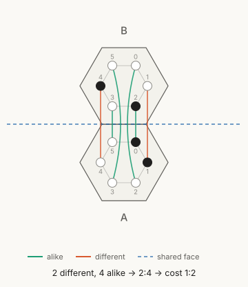

Game Design Documentation - Mechanisms
===

The following is a design spec and preliminary rules for an untitled game currently under design. These are far from the final rules and may be obtuse but can be reasonably used to develop the game further. The rules are flexible, as is the general topology of the game. This will remain as open as possible to offer flexibility for game modes as well as opportunities for optimization on templated and standard play modes.

> **Revision note (adapted-rules branch).** This revision folds in the decisions reached during simulation work in April 2026 (greedy-agent experiments on 2 to 6 player games, 61-cell hex boards). Clarifications agreed on 2026-10-10 (transfer cost as a rate, shell pairing by reflection, and the rules items listed in the table) are included too. Changed rules are summarized under [Revision Notes](#revision-notes) at the end. Items still undecided are listed there as open questions.

# Objective

The objective of the game is to hold the highest tally at the end of the final round. Tally is earned each round from the beacons a player owns. The game also ends early if one player is the last one remaining.

# Layout

## Units

Each player has associated units that act as both resources and area representation within the game. Each player's units have an associated color.
There shall also be uncolored unassociated units that appear in the shell within the cells (see Shell). These neutral units come from a supply that never runs out.

## Game Grid

The grid is a 2 dimensional arrangement of regular tiled polygons known as cells (triangles, squares, and hexagons for Euclidean spaces). Any sized cells can be used, with the limitation that all cell polygons have _2ⁿk_ sides, where _k_ is the smallest used cell polygon side count and n ≥ 1. The curvature of the 2D plane may vary, as may the topology. For the original game mode, the cells are hexagons on a standard Euclidean 2D plane.

The grid itself is amorphous and consists of a single contiguous group of adjacent cells. At every shared vertex of a cell there is a beacon position (a vertex shared by three interior hexagons touches three cells, and a boundary vertex touches two). The layout of the game board can be set from a template or generated randomly. The map also sets the starting state of every shell: a template lays the shells out by design, and a generated map draws them at random. The only constraints are that every cell is connected to at least one beacon and that the number of players is taken into account for the number of available cells.

Suggested hexagonal board sizes (axial coordinates, parameterized by radius):

| Radius | Cells | Players |
| ------ | ----- | ------- |
| 2      | 19    | 2 to 3  |
| 3      | 37    | 3 to 4  |
| 4      | 61    | 4 to 6  |

## Cells

Each cell consists of a store and a shell.

### Store

The cell store contains units belonging to any players. Several players may hold units in the same store at once (shared occupation). In the standard game the store has no capacity limit (see [Optional: Store Limit](#optional-store-limit)).

### Shell

The shell is an n-ary ring where n is the maximum number of polygon sides of any cell in the game (for a game of triangular [3 sides] and hexagonal [6 sides] cells, the ring has 6 nodes). The shell is physically represented as a ring or wall surrounding the store. Each position of the shell (known as a node) holds an unassigned unit or nothing (empty). In some game modes a node may hold a player's unit.

The nodes sit at the corners of a small hexagon inside the cell (the inner ring), turned the same way as the cell, so each node points at one corner of the cell. Those corners are the beacon positions, so every node sits beside a beacon position. Node _k_ points at the corner between edge _k_ and edge _k+1_, with edges numbered clockwise from the top (edge 0 is the top edge). So node 0 points at the right end of the top edge, and the nodes run clockwise from there, 0 to 5. The shell can be rotated clockwise and counterclockwise. Positions are discretized so that every node lands in the spot of a corresponding node, so a rotation is represented by a bit shift (circular shift) of the node positions.

For a hexagonal cell, the 6-node binary ring has 64 states that fall into 14 equivalence classes (necklaces) under rotation.

### Coffer

Each player has a coffer from which they place units onto the board, and into which other players may pay units.

### Tally

A running score tally is kept for all players.

## Beacons

At every shared vertex of a cell there is a beacon position. This position either holds a player's beacon marker or is empty. Once built, a beacon is permanent. It always scores for its current owner and can only change hands through capture (see Move 4).

# Concepts

## Payment

The cell store represents both area of control and local spending power for the given cell. To pay, unit(s) are removed from a cell store and discarded from the game or returned to storage.

## Adjacency

One cell is adjacent to another if they share a common edge.

## Occupation

A player occupies any cell whose store contains that player's units.

## Dominance

A player is dominant in any cell whose store contains more of their units than of any other single player's units. If there is a tie for the highest number of units, no player is dominant in that cell.

Dominance is checked at the moment each move is made, so it can change during a turn. A player who moves units into a cell and becomes dominant there can rotate its shell for free or use it toward a beacon in the same turn.

## Occupied and Vacant Shell Nodes

If a unit of any type, whether player or unassigned, exists in a particular node, that node is _occupied_. Otherwise it is _vacant_.

## Paying from the Cell Store

A player's capabilities are local to each cell. Actions taken at a cell are paid from the store of that cell unless otherwise noted.

## Cost and Cost-Free Moves

Most moves are at cost: to perform the move, one must expend units from the board. Passing is free. Moving units between cells is free when the crossing cost has a zero payment (see Calculating Costs). Shell rotation by a dominant player is free (see Move 3). Units handed to another player's coffer (Move 5) count as expended. A turn in which no units are expended by a player is a cost-free turn.

## Move Groups

The five move types fall into four groups:

| Group | Move types |
| ----- | ---------- |
| Units | Transfer (Move 1) and Destroy (Move 2) |
| Shells | Shell ops (Move 3): shift and modify |
| Beacons | Beacon (Move 4): build and capture |
| Payments | Pay into another player's coffer (Move 5) |

A turn has at most two stages. In the first, the player picks a group and makes any number of moves from it, at any cells and in any order. The player may then switch to a second group and make any number of moves from that one. Once the player has switched, they cannot go back to the first group, and they cannot start a third. Passing and ending the turn are always available.

Example: a player may orient their shells, then move units and attack. They may not orient, move, and then orient again. Either order is allowed: a player can move units into a cell, become dominant there, and then rotate its shell for free, but cannot then move units through the crossings the rotation opened.

The grouping is provisional and may change.

# Setup

Once a game board has been chosen and the rule variables have been set, a bidding round takes place. Each player is given x units to distribute among the coffers of all players, including their own. Each player makes this choice in secret. Once all players have chosen, the totals for each coffer are tallied and the players are ordered from least to most units. If any ties exist, the player with the least experience in the game goes last. If that fails to separate them, the order among ties is determined randomly. An additional 1 unit (or more, depending on established rules) is placed into each player's coffer.

Starting with the first player in the list, each player places any number of units from their coffer onto any cell's store on the board, provided that the cell does not contain another player's units, and up to the number of cells given by:

> max_cells_allowed = floor(total_cells / player_count)

Any units remaining in coffers are discarded.

NB: Alternatively, set positions and amounts can be determined per template with similar rules for turn order and selection.

# Gameplay

The game consists of two phases per round: an active phase followed by a harvest phase.

## Active Phase

During the active phase, players take turns in the current order. In the first round the order is the one decided during the initial bid. On a turn, a player may make moves from at most two move groups, one group after the other (see Move Groups above), or pass. The move types are:

1. Transfer units between cells
2. Destroy units
3. Shell ops (shift or modify a shell)
4. Beacon (build or capture)
5. Pay into another player's coffer

(See Active Phase Moves.)

The active phase ends once every active player, one after another, has had a cost-free turn or passed. Any turn that expends units restarts the count.

## Harvest Phase

All harvest income is computed from the board as it stands when the harvest phase begins, then added at once, so the order in which cells are evaluated does not matter.

Each player's tally increases by 1 for every beacon they own. Beacons score for their owner regardless of current dominance.

Every cell is then evaluated, and each player is rewarded units by these rules:

1. A player who is dominant in a cell receives one (1) unit into that cell's store.

2. Additionally, a player who is dominant in a cell receives one (1) unit into that cell's store for each adjacent cell the player occupies (up to 6 on a hexagonal grid).

The coffer totals are then counted. The order for the next round is determined from least to most units in the coffer, with ties going to the player who was earlier in the prior round.

Units in a player's coffer may be transferred to any cell store the player already occupies. Any units remaining in coffers are discarded.

A player who holds no units in any cell store after the harvest phase is inactive and takes no further turns. Their beacons stay on the board, keep scoring for them every round, and can still be captured. Their tally stands, so an inactive player can still win. (Provisional; to be revisited.)

If a player has been made inactive at this point, the setup may allow a buy-in, where the player is given _n_ units to place in any cell store as they see fit, regardless of whether that cell is already occupied.

## Active Phase Moves

### 1. Transfer Units Between Cells

A player may move units between adjacent cells at a possible cost. The cost is a rate written _p:m_: for every _m_ units moved, or any part of _m_, the player pays _p_ units. It is calculated for a given adjacency from the cell shells (see Calculating Costs). The payment is made from the player's units in the store of the cell they are moving from, and the paid units are discarded.

```
payment = ceil(n / m) × p          (n = units moved)
units taken from the store = n + payment
```

Example: a player holds 13 units in cell A and the cost to cell B is 2:5.

| Units moved | Blocks of 5 | Payment | Units taken from A |
| ----------- | ----------- | ------- | ------------------ |
| 3           | 1           | 2       | 5                  |
| 5           | 1           | 2       | 7                  |
| 9           | 2           | 4       | 13                 |
| 10          | 2           | 4       | 14 (not enough)    |

Moving 5 takes 7 units: 2 are paid and 5 move. Moving 10 would take 14, one more than the player holds, so the most the player can move is 9 (paying 4, using all 13). A partial block still costs the full _p_: a player holding only 5 units pays 2 and moves the remaining 3.

If the cost is _0:m_, any number of units may move freely to the adjacent cell. This is a cost-free move. If the cost is _p:0_, movement is blocked between the two cells and no units may move at any cost.

Units may move more than once in a turn, so a group can cross several cells in one turn, paying at each crossing. (Provisional; see open questions.)

#### Calculating Costs

_NB: this is here for explanation only. In the game app the calculation is handled by the game engine. Ideas are underway for a simple circuit-based method for physical copies. In the physical prototype this was tracked with a tracker laid over all of the edges of the adjacent cells, which was cumbersome but workable._

The cost of a move between adjacent cells is calculated by comparing the nodes of the two shells by reflection across the shared edge. Adjacent hexagons are mirror images of each other across the line of their shared edge, so reflecting cell A across that line lands each node of A exactly on one node of B. Those six pairs are compared. When A's edge _d_ is the shared edge, node _d+k_ of A pairs with node _d+2−k_ of B (indices mod 6). The two nodes of A that point at the ends of the shared edge pair with the two nodes of B that point at the same two corners, the side nodes pair with the side nodes, and the back nodes pair with the back nodes. Swapping A and B gives the same pairs, so the cost is the same in both directions.



In the figure, A's top edge is shared with B. Two pairs differ, so the cost is 2:4, which reduces to 1:2. The interactive version, [figures/crossing_pairing.html](figures/crossing_pairing.html), lets you choose the shared edge, fill and empty nodes, and rotate either shell.

A Hamming distance _H_ is calculated over the pairs on vacancies vs. occupancies. One by one, the pairs of nodes are compared on whether they are alike (both occupied or both vacant), and all of the dissimilar pairs are counted. The inverse Hamming distance _~H_ (the total shell size minus H, which is the number of similar pairs) completes the fraction _H:~H_. This is reduced by the greatest common divisor (a value of _2:4_ reduces to _1:2_). Thus:

```
H  = count of k in 0..5 where node (d+k) of A and node (d+2-k) of B differ
~H = Total - H
g  = gcd(H, ~H)
p  = H / g
m  = ~H / g

cost = p:m
```

Edge cases: H = 0 (every node matches its mirror partner) gives a free crossing with no cap on units moved, and H = Total (every pair dissimilar) blocks the crossing.

On hexagonal cells (Total = 6) only these costs can occur:

| H | ~H | Cost | Moving 1 unit | Moving 6 units |
| - | -- | ---- | ------------- | -------------- |
| 0 | 6  | free | 0             | 0              |
| 1 | 5  | 1:5  | 1             | 2              |
| 2 | 4  | 1:2  | 1             | 3              |
| 3 | 3  | 1:1  | 1             | 6              |
| 4 | 2  | 2:1  | 2             | 12             |
| 5 | 1  | 5:1  | 5             | 30             |
| 6 | 0  | blocked | -          | -              |

The 2:5 in the transfer example is for illustration and cannot occur on a 6-node shell, since the reduced _p_ + _m_ always divides the shell size.

The reduced form separates into a direction (the quotient p:m) and a scale (g, the GCD), both derived from a single Hamming comparison. Reduction only changes the price of a partial block: unreduced, 2:4 would charge 2 to move a single unit, while the reduced 1:2 charges 1. Because the GCD is unintuitive for players, a player-facing presentation may prefer to show only the resulting p:m.

### 2. Destroy Units

This action occurs locally to a store. If the active player occupies the same cell as another player, the active player may spend one unit from that store to destroy and discard one of the other player's units, one-for-one. Example: Player A has 5 units in a store with 3 units of Player B. Player A removes a unit one-for-one two times, leaving Player A with 3 units and Player B with 1.

### 3. Shell Ops

Shell ops cover two operations that share one move type: shifting a shell and modifying it.

**Shift (rotate).** A player who is dominant in a cell may rotate that cell's shell clockwise or counterclockwise by any number of positions at no cost. Without dominance, a shift costs 1 unit from the cell store (or more, depending on game settings).

**Modify.** Any player with units in a cell may modify its shell; dominance is not needed, and neither is an adjacent beacon. For a cost of 1 unit from the corresponding cell store (or more, depending on game settings), the player may either:

1. Remove and discard a unit from any occupied node of the cell shell, or
2. Add a neutral unit from the supply to a vacant node of the cell shell. The unit paid is discarded.

### 4. Beacon (Build or Capture)

A beacon action is allowed only when the player is dominant in **all** cells adjacent to the beacon position, whether or not the position is occupied.

**Build.** On an empty position, the player places a beacon marker in their color, at a cost paid **from each adjacent store**. The marker itself is not paid for; the cost is only the units paid from the adjacent stores. The baseline cost is 1 to 2 units per adjacent store, set by the game configuration.

**Capture.** On a position owned by another player, the player replaces the owner's marker with their own at a reduced cost, baseline 1 unit from each adjacent store. Capture is cheaper than building because the real price is the dominance needed in every adjacent cell.

A beacon never deactivates. It scores for its current owner and changes hands only through capture.

### 5. Pay Into Another Player's Coffer

A player may place any number of units from any cell's store into any _other_ player's coffer. There is no fee beyond the units handed over, but those units count as expended, so a turn that includes a payment is not cost-free.

# End of Game

The game continues for as many rounds as decided. Once the final harvest has taken place, the winner is the player with the highest tally. Ties may be broken by the player with the greatest number of dominant cells.

# Optional: Store Limit

The original design capped the units any cell store could hold at a limit _L_. Simulations showed that harvest income and spending settle at an equilibrium of about 5 units per cell with no cap, so the cap is redundant in the standard game. It remains available as a variant for game modes that want it:

- The store total may not exceed _L_ at the end of a turn. A player may exceed _L_ temporarily during their turn and must reduce their own pieces afterwards to bring the store back under the limit.
- Harvest income stops once a store reaches _L_.
- Setup placement and coffer transfers stop at _L_.

# Revision Notes

## Changes from the original spec

| Area | Original | This revision |
| ---- | -------- | ------------- |
| Move types | 6 (transfer, destroy, shift, modify, beacon, pay) | 5 (shift and modify merged into shell ops) |
| Moves per turn | Any two move types, freely mixed | Two of four groups (units, shells, beacons, payments), one after the other with no going back (provisional) |
| Shell rotation | Costs 1 unit | Free and unlimited for a dominant player, 1 unit otherwise |
| Store limit L | Required, with overburden rules | Removed from the standard game, kept as an optional variant |
| Beacon creation | 3 units from each adjacent store | Configurable, baseline 1 to 2 from each adjacent store |
| Beacon capture | Not defined | Allowed with dominance in all adjacent cells, baseline 1 per adjacent store |
| Beacon permanence | Unspecified | Permanent once built, scores for the owner every round, changes hands only by capture |
| Objective | Beacons held across rounds | Highest tally, earned at 1 per beacon per round |
| ~H definition | Written as "Hamming distance - total shell size" | Corrected to Total - H |
| Transfer cost | Worded as "pay p, then move up to m", which reads as a one-time cap | Clarified as a rate: moving n units costs ceil(n / m) × p |
| Shell pairing | "In a reflective manner" | Nodes point at the cell's corners and pair by reflection across the shared edge: node d+k of A with node d+2−k of B |
| Shell modify | Required an adjacent owned beacon | Anyone with units in the cell, 1 unit, no beacon or dominance needed |
| Starting shells | Unspecified | Part of the map: set by a template or drawn at random |
| Dominance timing | Unspecified | Checked at the moment of each move |
| Beacon piece | A player's unit | A marker, not paid for; the cost is the units from adjacent stores |
| Coffer payment | "At-cost" | No extra fee; the units handed over count as expended |
| Harvest timing | Unspecified | Computed from the board at the start of harvest, applied at once |
| Active phase end | Every player consecutively cost-free or passed | Same, counting active players; any costly turn restarts the count |
| Inactivity | No units placed from the coffer in harvest | No units in any store after harvest; beacons and tally stay (provisional) |

## Simulation findings behind the changes

1. Shell engagement needs free rotation for a dominant player. With a paid rotation, shell moves were 0.2% of activity. With free rotation they were 57%, and bundling rotation with modification into one move type raised engagement to 94%.
2. Weight-3 shells (half-filled rings) are the common equilibrium, because they allow the most rotational flexibility.
3. Spread patterns beat clustered ones, because rotating a spread pattern swings the Hamming distance more across different edges.
4. Frontline cells favor asymmetric blocking patterns, and interior cells favor open symmetric patterns.
5. The unit cap is mechanically redundant (see Optional: Store Limit).
6. The coordination needed to hold dominance in all three cells around a vertex is the main bottleneck for beacons, more than their unit cost. Cheap capture makes beacons contested assets, since a rival only needs to break dominance in one cell of the triangle, take the other two, and flip the beacon.
7. Greedy agents did not reproduce the multiplayer diplomacy the design intends (spoiling, focusing the leader, shared occupation). Evaluating that layer needs self-play reinforcement learning or human playtests.

## Open questions

See [open_questions.md](open_questions.md) for the context and options on each.

- Can units move more than once per turn? Allowed for now.
- Baseline beacon build cost: 1 or 2 units per adjacent store.
- Exact tie-break ordering for turn order beyond "earlier in the prior round".
- Starting setup without the bid: units per player, starting cells, board sizes.
- Does the game still end early when one active player remains, now that inactive players keep scoring?
- The inactivity rule is provisional.
